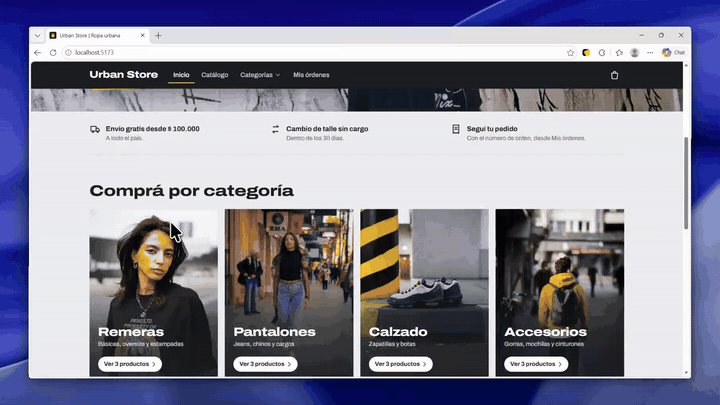

# 🛍️ Urban Store

Tienda online de ropa urbana: remeras, pantalones, zapatillas y accesorios.
Es mi proyecto final del curso de **React JS de CoderHouse**.

👉 **Probala online:** https://urban-store-cristianatrio.web.app

> Es una tienda de prueba: podés comprar todo lo que quieras, no se cobra ni se
> envía nada.

## 🎬 Mirá cómo funciona

[](docs/demo.mp4)

▶️ [Ver el video completo (1 minuto y medio)](docs/demo.mp4)

## 💡 La idea

Elegí ropa urbana y quise que se sintiera como una tienda online de verdad:

- La portada muestra una foto grande, las categorías y lo más elegido, sin
  amontonar todo.
- El catálogo completo tiene su propia página, con filtros para encontrar rápido
  lo que buscás.
- Al agregar algo al carrito, la tienda te sugiere con qué combinarlo y te avisa
  cuánto te falta para el envío gratis.
- Si te olvidaste de algo, podés modificar tu pedido después de comprar.

## ✨ Qué podés hacer

- **Recorrer el catálogo** por categoría, buscar por nombre y ordenar por precio.
- **Agregar al carrito** y recibir ideas para completar el look.
- **Saber cuánto te falta para el envío gratis**, que es desde $100.000.
- **Comprar** completando tus datos. Al terminar recibís un número de pedido.
- **Ver tu pedido** cuando quieras, con ese número, desde "Mis órdenes".
- **Modificar el pedido**: sumar o sacar productos sin volver a cargar tus datos.
- **No perder el carrito**: queda guardado aunque cierres la página.
- **Usarla en el celular** o en la computadora.

## 🛒 Hacé una compra de prueba

1. Entrá a la [tienda](https://urban-store-cristianatrio.web.app) y elegí un producto.
2. Tocá **Agregar** y después **Finalizar compra**.
3. Completá el formulario con datos inventados y tocá **Realizar compra**.
4. Copiá el número de pedido que te aparece.
5. Entrá a **Mis órdenes**, pegá el número y tocá **Modificar el pedido** para
   cambiar lo que compraste.

## 🧰 Con qué está hecha

- **React**: la herramienta con la que se arma la página y todo lo que pasa en ella.
- **Firebase** (de Google): guarda los productos y los pedidos en la nube, y
  publica la tienda en internet.
- Las fotos son de [Unsplash](https://unsplash.com), un banco de imágenes libres.

---

## 👩‍💻 Para desarrolladores

<details>
<summary><strong>Cómo correr el proyecto</strong></summary>

```bash
git clone https://github.com/cristianatrio/urban-store-react.git
cd urban-store-react
npm install

# Copiar .env.example como .env y completar las credenciales de tu proyecto
# de Firebase (https://console.firebase.google.com)
cp .env.example .env

npm run seed   # carga el catálogo inicial (colecciones items y categories)
npm run dev    # http://localhost:5173
```

- Recargar el catálogo desde cero: `node --env-file=.env scripts/seed.js --force`
- Actualizar fotos, textos y destacados sin tocar el stock:
  `node --env-file=.env scripts/seed.js --update`
- Publicar: `firebase deploy` (compila con `vite build` y publica reglas y hosting).

> El seed escribe desde el cliente: solo funciona mientras las reglas permitan
> escribir `items` y `categories` (por ejemplo, en modo de prueba). Con
> `firestore.rules` publicadas, el catálogo es de solo lectura.

</details>

<details>
<summary><strong>Requisitos de la consigna de CoderHouse</strong></summary>

- Portada en `/` con hero (foto distinta para celular y PC), categorías y
  destacados. Catálogo completo en `/catalogo` (`ItemListContainer`) y por
  categoría en `/categories/:categoryId`, desde el menú o las cards de la portada.
- Detalle en `/item/:id` con foto, descripción, precio y selector de cantidad
  (`ItemDetailContainer`). Si el producto no existe se muestra un aviso.
- `CartWidget` en el NavBar con el total de unidades, siempre visible → `/cart`.
- Carrito con edición de cantidades, eliminación de productos y total.
- Checkout con **Brief** (subtotal, envío y total) y formulario de nombre,
  apellido, teléfono y e-mail repetido. **Realizar compra** se activa solo con el
  formulario válido.
- La orden se guarda en `orders` (Firestore) con los productos, precios al momento
  de la compra, total, fecha y estado `generada`, y se muestra el **order id**.
- Navegación 100% con React Router (sin `href` ni `location`).

**Extras:** categorías dinámicas desde Firestore, filtros y búsqueda en el
catálogo, envío gratis con barra de progreso, panel de carrito con combos y
sugerencias, carrito en `localStorage`, control de stock y precio en una
transacción, "Mis órdenes" (`/orders`, `/order/:orderId`) y modificación de
pedidos.

</details>

<details>
<summary><strong>Cómo funciona modificar un pedido</strong></summary>

"Modificar el pedido" pasa los productos al carrito con el precio y el stock de
hoy. En `/checkout` se revisan los cambios y se confirman sin formulario (se usan
los datos del pedido original). En una sola transacción:

- se crea la versión nueva, con `basedOn` apuntando al original;
- el original pasa a `modificada`, con `replacedBy` apuntando al nuevo;
- el stock se ajusta solo por la diferencia: lo que se saca vuelve al stock.

</details>

<details>
<summary><strong>Firestore: datos y reglas</strong></summary>

| Colección    | Campos |
| ------------ | ------ |
| `items`      | `title`, `price`, `category`, `stock`, `sold` (vendidos), `image`, `description`, `featured`, `lastReturn` (último pedido que devolvió stock) |
| `categories` | `key`, `description`, `tagline`, `image`, `order` |
| `orders`     | `buyer`, `items[]` (id, title, description, price, quantity), `subtotal`, `shipping`, `total`, `date`, `status` (`generada` / `modificada`), `basedOn`, `replacedBy` |

Reglas (`firestore.rules`):

- `categories` es de solo lectura.
- En `items` solo se mueven unidades entre `stock` y `sold`, sin que `stock + sold`
  crezca. Devolver stock solo se permite en la misma operación que marca un pedido
  como `modificada`.
- Las órdenes se crean con datos válidos (`total = subtotal + envío`) y se consultan
  por id, pero no se listan ni se borran. Solo pueden pasar de `generada` a
  `modificada`, al crear su versión nueva y para el mismo comprador.

`firebase.json` redirige todas las rutas a `index.html` para que React Router
funcione al recargar. `index.html` no se cachea; los archivos de `assets/` sí.

</details>

<details>
<summary><strong>Estructura del proyecto y librerías usadas (con su justificación)</strong></summary>

```
src/
├── components/        # NavBar, Home, Hero, catálogo, detalle, carrito, checkout, órdenes
├── context/           # CartContext: carrito, envío, total y pedido en modificación
├── hooks/             # catálogo cacheado y título de la pestaña
├── firebase/config.js
├── services/          # lecturas y transacciones de Firestore
├── styles/            # CSS propio: base, layout, home, catalog, cart
└── utils/             # precios, envío, recomendaciones y avisos del carrito
docs/                  # video de demostración
archivo/               # consigna en PDF y material anterior, fuera de la app
```

| Librería | Para qué |
| --- | --- |
| [react-router-dom](https://github.com/remix-run/react-router) | Navegación por rutas sin recargar la página. |
| [firebase](https://github.com/firebase/firebase-js-sdk) | Firestore como base de datos de productos, categorías y órdenes. |
| [vite](https://github.com/vitejs/vite) | Servidor de desarrollo y build, con variables de entorno para Firebase. |

Sin librerías de UI: todo el diseño es CSS propio. Tipografía
[Archivo](https://fonts.google.com/specimen/Archivo) (Google Fonts).

</details>

<details>
<summary><strong>Créditos de las fotos</strong></summary>

Fotos de [Unsplash](https://unsplash.com), bajo la
[licencia de Unsplash](https://unsplash.com/license). Están en `public/images/`.

| Archivo | Autor | Foto original |
| --- | --- | --- |
| `hero-desktop.webp`, `hero-mobile.webp` | Mike Von | https://unsplash.com/photos/dwvtsZsyTZw |
| `cat-remeras.webp` | sammy swae | https://unsplash.com/photos/QVjye9U1kuQ |
| `cat-pantalones.webp` | Khalid Boutchich | https://unsplash.com/photos/CIb--tC_gIE |
| `cat-calzado.webp` | Vlad Ciutacu | https://unsplash.com/photos/ivmrxBe-Dxg |
| `cat-accesorios.webp` | Mika Baumeister | https://unsplash.com/photos/iEsxPaROaiI |
| `remera-oversize-negra.webp` | ian dooley | https://unsplash.com/photos/kkj9iKxsdhY |
| `remera-retro-wave.webp` | Taylor (xoutcastx) | https://unsplash.com/photos/bdYJWXg4pK4 |
| `remera-basica-blanca.webp` | Mediamodifier | https://unsplash.com/photos/fTDWpCxLA0k |
| `jean-slim-azul.webp` | KAi'S PHOTOGRAPHY | https://unsplash.com/photos/2s3GhhJz2uY |
| `chino-beige.webp` | MARK ADRIANE | https://unsplash.com/photos/-uJ3N7HLiEg |
| `jogger-cargo-verde.webp` | DJ Tears PLK | https://unsplash.com/photos/ZsUCBnNx5_0 |
| `zapatillas-urbanas-blancas.webp` | Bear Bear | https://unsplash.com/photos/bzYvnk6SoIQ |
| `zapatillas-running-grises.webp` | Tanaphong Toochinda | https://unsplash.com/photos/WWDMEVcGPbU |
| `botas-cuero-marron.webp` | Zac Wolff | https://unsplash.com/photos/esxf7PJmExQ |
| `gorra-trucker-negra.webp` | Chris Lynch | https://unsplash.com/photos/zjN-PXwGKJE |
| `mochila-urbana-gris.webp` | 9am herday | https://unsplash.com/photos/6PDjpd1Jr2s |
| `cinturon-cuero.webp` | Muhammet SAIN | https://unsplash.com/photos/tRu15nFN3Pw |

</details>
